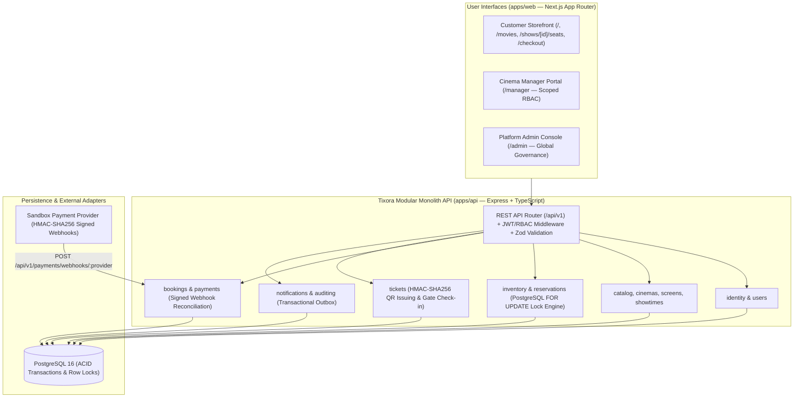

# Tixora V1 — System Architecture Blueprint

## 1. Architectural Philosophy: Production-Minded Modular Monolith

Tixora V1 is engineered as a **Modular Monolith** using **Node.js + Express + TypeScript** on the backend, **Next.js (App Router) + Tailwind CSS + TanStack Query** on the frontend, and **PostgreSQL** as the single authoritative source of truth.

## 2. Module Boundaries (`apps/api/src/modules/`)

| Module | Responsibility | Key Guarantees |
| :--- | :--- | :--- |
| `common` | Config, Pino secret-redacted logging, `AppError`, OpenAPI 3.0 spec | Standardized JSON error envelopes |
| `identity` | Registration, login, JWT access tokens, rotating refresh sessions, RBAC | Replay protection on rotated refresh tokens |
| `users` | Customer profile, preferred city, booking & ticket history | Strict ownership isolation |
| `catalog` | Movie CRUD, search, language/genre/status filters | Slug & UUID lookup support |
| `cinemas` | Cities, cinema locations, facility metadata | Cinema-level staff scoping (`cinema_staff`) |
| `screens` | Auditorium dimensions, turnaround buffers, physical seat matrices | Protects sold/held seats when updating layouts |
| `showtimes` | Show scheduling, category pricing, overlap detection | Rejects overlapping screenings + turnaround buffers (`409 Conflict`) |
| `inventory` | Per-show seat availability (`show_seats`), lazy & scheduled hold expiry | Real-time state transitions |
| `reservations` | Multi-seat atomic holds (`seat_holds`, `seat_hold_items`) | Deterministic lock ordering (`ORDER BY seat_code ASC FOR UPDATE`) |
| `bookings` | Pending-payment bookings, idempotency keys, cancellation rules | Idempotent creation; automatic seat release on cancel |
| `payments` | Payment intents, HMAC webhook verification, late-payment reconciliation | Separates payment state from seat confirmation |
| `tickets` | Cryptographic `TXQR` token generation and gate validation | Prevents forged QR codes and duplicate check-ins |
| `notifications` | Transactional outbox processor & background workers | Crash-resilient asynchronous processing |
| `administration` | Cinema Manager & Platform Admin reporting and governance | Enforces `assertCinemaAccess` on every manager action |
| `auditing` | Immutable administrative and security audit trail (`audit_logs`) | Full traceability of state changes |

## 3. Evolution Path Toward FlowGuard Gateway Integration

Because all business endpoints are cleanly versioned under `/api/v1` with stateless Bearer JWT verification and idempotency keys (`idempotency_key` on `bookings` and `payments`), **FlowGuard** can be deployed directly in front of `apps/api` as an L7 traffic shaper, token-bucket rate limiter, and virtual waiting-room queue for blockbuster movie drops without altering Tixora's transactional core.

