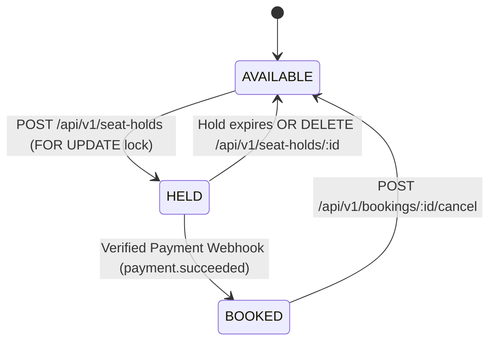

# Tixora V1 — Concurrency-Safe Seat Reservation & Booking Lifecycle

## Seat State Machine



## Concurrency & Deadlock Prevention Guarantees

1. **Deterministic Lock Ordering**:
   When a customer requests multiple seats (e.g., `['D7', 'D5', 'D6']`), the backend normalizes, deduplicates, and sorts the codes alphabetically (`['D5', 'D6', 'D7']`) before executing:
   ```sql
   SELECT id, seat_code, category, price, status
   FROM show_seats
   WHERE show_id = $1 AND seat_code = ANY($2::varchar[])
   ORDER BY seat_code ASC
   FOR UPDATE
   ```
   Acquiring row locks in ascending `seat_code` order eliminates circular wait conditions (deadlocks) between concurrent multi-seat transactions.

2. **All-or-Nothing Multi-Seat Semantics**:
   If even a single seat in the requested array is `HELD`, `BOOKED`, or `BLOCKED`, the transaction rolls back immediately and returns `HTTP 409 CONFLICT` with the exact list of unavailable seats.

3. **Authoritative Expiry Recovery**:
   Expired holds (`expires_at <= NOW()`) are released both lazily inside `releaseExpiredHolds()` before every seat read/hold transaction and periodically via the background worker in `notifications.module.ts`.

