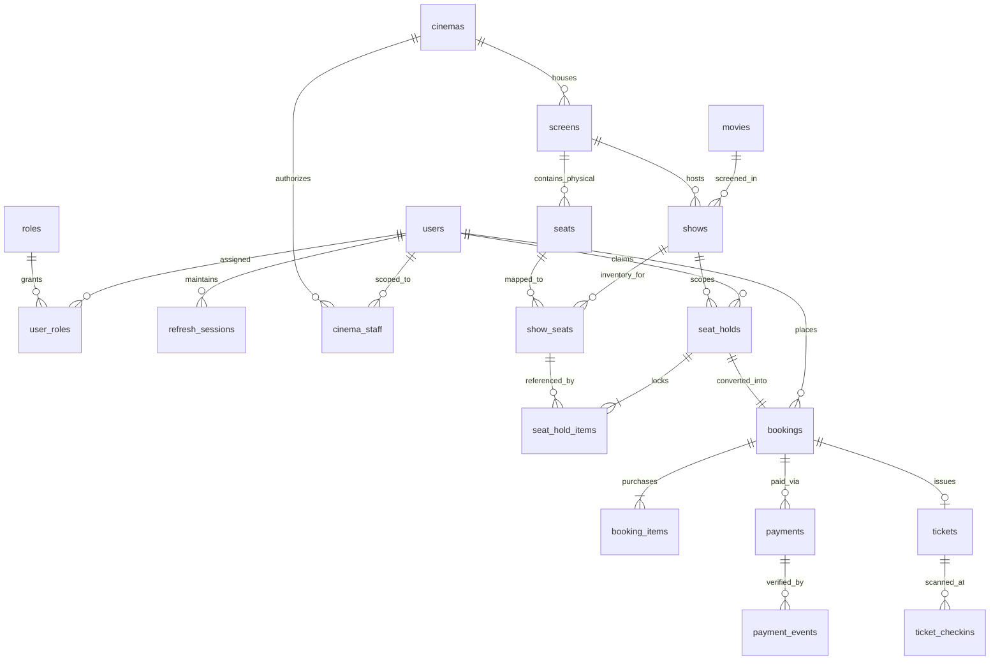

# Tixora V1 — PostgreSQL Database Schema & Constraints

All schema definitions are versioned in [`apps/api/src/db/migrations/V1__init_schema.sql`](../apps/api/src/db/migrations/V1__init_schema.sql) and seeded via [`apps/api/src/db/seed.ts`](../apps/api/src/db/seed.ts).

## Entity Relationship Diagram

## Core Tables & Integrity Constraints

1. **`users`, `roles`, `user_roles`, `refresh_sessions`, `cinema_staff`**
   - Unique email on `users(email)`.
   - Rotating refresh token hashes (`SHA-256`) stored in `refresh_sessions(token_hash)` with `replaced_by_session_id` and `revoked_at`.
   - `cinema_staff` enforces `UNIQUE (cinema_id, user_id)` for resource-scoped RBAC.

2. **`movies`, `cinemas`, `screens`, `seats`**
   - `screens` enforces `UNIQUE (cinema_id, name)` and tracks `turnaround_minutes` and `layout_version`.
   - `seats` enforces `UNIQUE (screen_id, seat_code)` and `UNIQUE (screen_id, grid_row, grid_col)`.

3. **`shows` & `show_seats` (Authoritative Per-Show Seat Inventory)**
   - `shows` stores `start_time`, `end_time`, and `turnaround_end_time` (`CHECK (end_time > start_time)` and `CHECK (turnaround_end_time >= end_time)`).
   - `show_seats` enforces `UNIQUE (show_id, seat_id)` and `UNIQUE (show_id, seat_code)` so the same physical seat can never be duplicated within a showtime.
   - `status` check constraint: `CHECK (status IN ('AVAILABLE', 'HELD', 'BOOKED', 'BLOCKED'))`.

4. **`seat_holds`, `seat_hold_items`, `bookings`, `booking_items`**
   - `bookings` enforces `UNIQUE (hold_id)` and `UNIQUE (idempotency_key)` to guarantee duplicate checkout requests never create duplicate bookings.
   - Monetary columns (`subtotal_amount`, `convenience_fee`, `tax_amount`, `total_amount`, `price`) use exact `NUMERIC(10, 2)` representation alongside `currency VARCHAR(3)`.

5. **`payments`, `payment_events`, `tickets`, `ticket_checkins`, `audit_logs`, `outbox_events`**
   - `payment_events(event_id)` is `UNIQUE`, guaranteeing webhook idempotency.
   - `tickets(qr_token)` and `tickets(ticket_code)` are `UNIQUE`.

