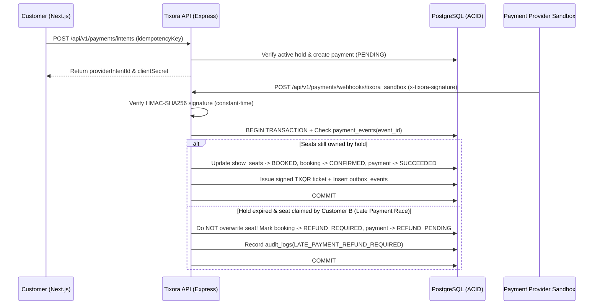

# Tixora V1 — Payment Lifecycle & Late-Payment Reconciliation

## Separation of Payment State and Seat Confirmation

In Tixora, a payment callback from the frontend never directly confirms a ticket. Only a cryptographically verified webhook (`x-tixora-signature` HMAC-SHA256) processed by `PaymentsService.processWebhook()` can transition a booking to `CONFIRMED`.

## Handling the Late-Payment Race Condition
If Customer A's 8-minute hold expires while their bank takes 9 minutes to clear payment, and Customer B claims the seat in the meantime:
1. When Customer A's `payment.succeeded` webhook arrives, `processWebhook` locks the `show_seats` rows (`FOR UPDATE`).
2. It detects that `active_hold_id !== booking.hold_id`.
3. **It never double-books the seat.** Instead, it transitions Customer A's booking to `REFUND_REQUIRED` and payment to `REFUND_PENDING`, which the background reconciliation job automatically refunds.

